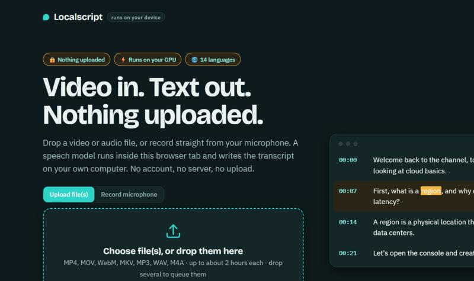

# Localscript — video/audio to text

Turn a video or audio file into a timestamped, editable transcript. Built two ways, same idea: **your recording stays private** — until you choose the hosted one.

[](LICENSE)
[](https://video-transcription-app-2027.streamlit.app/)



**Try it now:** [video-transcription-app-2027.streamlit.app](https://video-transcription-app-2027.streamlit.app/) (hosted, Streamlit edition) — or run the [website](website) locally for the fully private, nothing-uploaded version (see Quick start below).

## Two ways to use it

| | [`website/`](website) (static, no build step) | [`streamlit_app/`](streamlit_app) |
|---|---|---|
| Runs | Entirely in your browser (Whisper via [transformers.js](https://github.com/huggingface/transformers.js)) | On a server (Whisper via [faster-whisper](https://github.com/SYSTRAN/faster-whisper)) |
| Your file | Never leaves your device | Uploaded to wherever the app runs |
| Hosting | Any static host, free | Streamlit Community Cloud, free |
| Best for | Privacy, no install | A hosted link you can share, Python-based workflows |

## Features

- Drop a file, drag-drop several to queue them, or record straight from your microphone
- 14 languages, with automatic detection and optional translation to English
- Word-level timestamps — the exact word being spoken highlights as the video plays
- Click any timestamp to jump the video there; edit any line inline
- Search the transcript, copy a single line, or export `.txt`, `.srt`, `.vtt`, or a bundled `.zip`
- On-device history (website version) — revisit or delete past transcripts, nothing leaves your browser
- Dark/light mode, keyboard shortcuts (`Space` play/pause, `←`/`→` seek)

## Quick start

**Website** (no install, works offline after the first load):
```powershell
cd website
python -m http.server 8000
```
Open `http://localhost:8000` in Chrome or Edge. (Opening `index.html` directly by double-click will show a warning — browsers block the speech worker for `file://` pages.)

**Streamlit app** (needs Python + ffmpeg):
```powershell
cd streamlit_app
pip install -r requirements.txt
streamlit run app.py
```
See [`streamlit_app/README.md`](streamlit_app/README.md) for deployment to Streamlit Community Cloud.

## Code layout (`website/`)

```
website/
├── index.html        markup only
├── css/styles.css     all styling (light/dark theme via CSS variables)
└── js/
    ├── main.js        app entry point — owns state, wires up every feature
    ├── ui.js          DOM rendering: transcript rows, history list, toasts
    ├── db.js          data layer — transcript history (IndexedDB)
    ├── audio.js       turns a dropped file into 16 kHz PCM (3 routes, up to ~2h)
    ├── formats.js     TXT/SRT/VTT export + zero-dependency ZIP writer
    ├── theme.js       dark/light mode
    ├── recorder.js    microphone recording feature
    ├── queue.js       batch file queue feature
    └── worker.js      the Whisper transcription engine (runs off the main thread)
```
Plain ES modules, no bundler or build step — open `index.html` through a local server (see Quick start) and the browser resolves the imports directly.

## Why both exist

The website is the privacy-first default — nothing you record or upload ever leaves your machine. The Streamlit app trades that off for a shareable hosted link and a Python-based pipeline, useful when you want to send someone a URL instead of a file.

## Contributing

Issues and pull requests are welcome.

1. **Fork and clone** the repo, then pick the app you're changing — `website/` or `streamlit_app/`. They're independent; a change to one doesn't require touching the other.
2. **Website changes:** edit the relevant module under `website/js/` (keep the one-feature-per-file split: UI rendering in `ui.js`, history in `db.js`, export logic in `formats.js`, etc. — don't reach into another module's internals). Run it locally (`cd website && python -m http.server 8000`) and check the browser console is clean before opening a PR.
3. **Streamlit changes:** edit `streamlit_app/app.py`. Syntax-check with `python -m py_compile streamlit_app/app.py`, and run it locally (`streamlit run app.py`) if you have `ffmpeg` and the dependencies installed.
4. **Keep the privacy boundary intact.** The website must never send a user's file or transcript anywhere — if a feature needs a network call, it has to be opt-in and clearly labeled. The Streamlit app already uploads by design, so this only applies to `website/`.
5. **Commit messages:** short, imperative, describe the *why* when it's not obvious from the diff.
6. Open a PR describing what changed and how you tested it (a screenshot or GIF helps for UI changes).

Found a bug or have a feature idea but don't want to build it yourself? Open an issue — include your browser/OS for website bugs, or the error message for Streamlit ones.

## License

[MIT](LICENSE)
